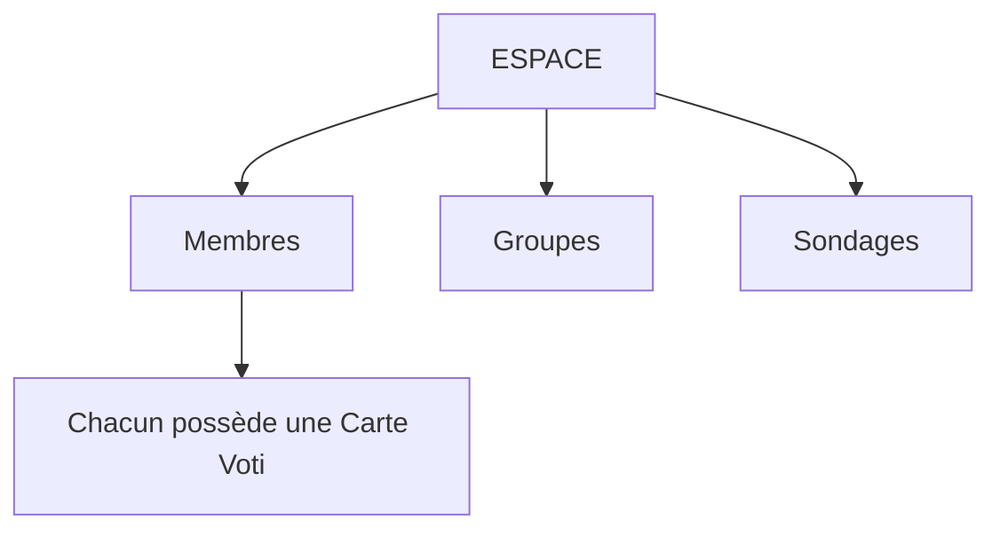
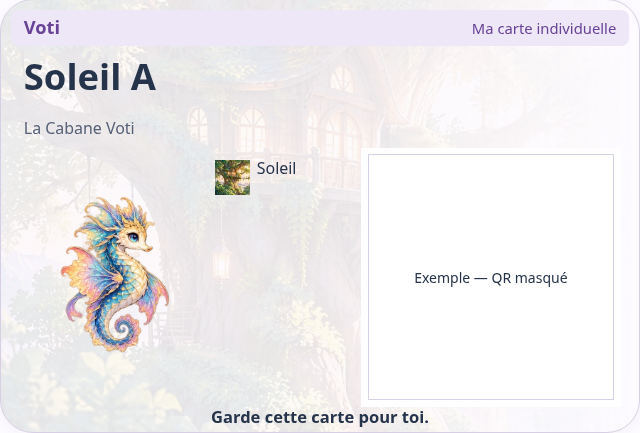
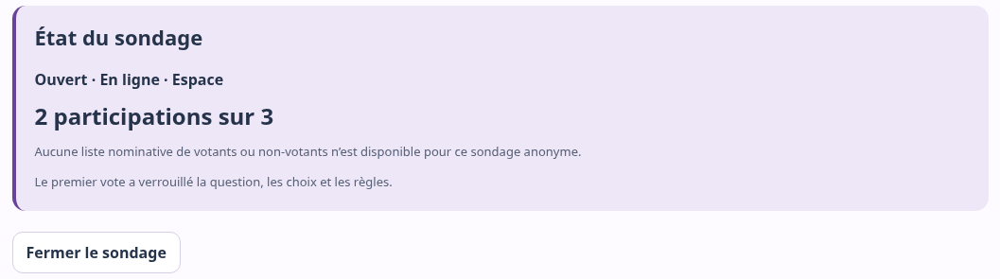
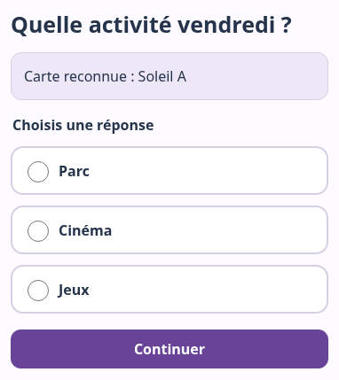
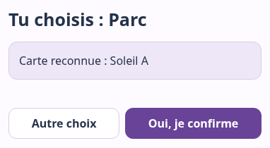

# Démarrage rapide Voti

<!-- D1, source éditable — 26 octobre 2026.
Dérivé de VOTI_GUIDE.md, référence applicative 601aeb04c171fae6b4f4928d694f9ce8c4ddf190.
Quatre pages A4 portrait : chaque repère PAGE ouvre une page ; trois sauts seulement.
Montage : corps 12 pt au minimum, marges 15–18 mm, interligne confortable.
Quatre captures déjà nettoyées + S1 et S3 = six visuels ; aucune nouvelle capture.
Conserver les légendes, surtout celle de C31, et la page Participant autonome.
Mise en page et export : guides/build_guides.py ; contrôler les pages après modification.
-->

## Page 1 — Découvrir Voti

Voti permet de participer simplement à des choix ou sondages grâce à des
**Cartes Voti individuelles** : choisir une activité, décider d’une sortie,
recueillir un avis ou organiser un choix collectif.

### S1 — Comment Voti s’organise

Un **membre** représente une personne, avec un nom ou pseudonyme. Un **groupe**
rassemble certains membres ; une personne peut appartenir à plusieurs groupes.
Un **sondage** concerne tout l’Espace ou les groupes choisis.

### S3 — Quel est votre rôle ?

| Rôle | Ce qu’il permet |
| --- | --- |
| **Administrateur** | Préparer et gérer l’Espace, les membres, groupes, Cartes et accès ; créer aussi des sondages |
| **Créateur** | Créer et suivre les sondages dans son périmètre autorisé |
| **Participant** | Utiliser sa Carte pour répondre aux sondages auxquels il peut participer |

**Ces rôles décrivent ce que chacun peut faire dans Voti. Ils ne dépendent ni de
l’âge ni du contexte d’utilisation.**

### Commencer au bon endroit

Ouvrez [Voti](https://luuma8888.github.io/voti/) avec Internet.
Pour gérer un Espace, choisissez **Espaces & groupes** : préparation page 2,
sondage page 3. Avec une Carte de Participant, utilisez directement la **page 4**.

> **Accéder facilement à Voti**
> Voti fonctionne dans le navigateur. Sur un appareil compatible, vous pouvez
> aussi l’installer pour obtenir une icône et une fenêtre dédiée.
> Voir [Installer Voti dans le guide complet](VOTI_GUIDE.md#installer).
> L’installation ne transfère pas les accès et ne remplace pas Internet.

**Pour aller plus loin :** [Guide Voti — Comprendre et utiliser](VOTI_GUIDE.md).

## Page 2 — Préparer son premier sondage

**Administrateur :** préparez l’Espace. **Créateur :** demandez à l’Administrateur
les membres, le groupe et les Cartes prêts, puis passez page 3 avec votre accès.

**Exemple fictif : La Cabane Voti**, groupe **Soleil**, membres **Soleil A/B/C**.

### 1. Créer ou ouvrir l’Espace

Dans **Espaces & groupes**, utilisez **Mes Espaces → Ouvrir** si l’accès est déjà
présent. Sinon, importez le fichier reçu avec **Choisir un fichier**, ou dépliez
**Créer un Espace**, nommez-le et confirmez la création. Effectuez la vérification
humaine si demandée.

Conservez votre accès : **Réglages → Exporter mon accès SECRET**. Gardez le fichier
en privé ; il permet de retrouver vos droits de gestion.

### 2. Créer le groupe utile

Dans **Groupes → Nouveau groupe**, saisissez **Soleil**, puis **Créer le groupe**.
Le préparer avant les membres permet de le cocher dès leur création.

### 3. Ajouter les membres

Dans **Membres → Ajouter un membre**, saisissez **Soleil A**, cochez **Soleil**,
puis **Créer le membre et sa carte**. Téléchargez sa Carte. Faites de même pour
Soleil B et Soleil C. Une illustration est facultative.

Membre déjà présent ? **Voir → groupes → Enregistrer**, depuis sa fiche.

### 4. Vérifier et remettre les Cartes

Vérifiez pseudonyme et Espace, puis **Télécharger cette carte (PDF SECRET)**.
Imprimez si utile et remettez chaque Carte à la bonne personne.
**Téléchargez avant de recharger ou fermer l’onglet.**

*C14 — Une Carte appartient à un membre et sert à participer. Gardez-la avec soin :
ce n’est pas un accès Administrateur ou Créateur.*

**Espace, membres, groupes et Cartes se réutilisent pour les prochains sondages.**
Détails : [Membres](VOTI_GUIDE.md#membres), [Groupes](VOTI_GUIDE.md#groupes) et
[Cartes Voti](VOTI_GUIDE.md#cartes).

## Page 3 — Créer, publier et suivre

**Administrateur ou Créateur autorisé.** **Création express** : rapide, réglages
recommandés. **Création guidée** : étape par étape. **Réglages avancés** : tous
les réglages réunis.

### Un premier sondage Express

1. Ouvrez **Sondages → Nouveau sondage → Création express** dans l’Espace,
   pas depuis le bouton global du Mode libre.
2. Écrivez **Quelle activité vendredi ?** Ajoutez les réponses **Parc**, **Cinéma**
   et **Jeux**, avec **Ajouter une réponse** si nécessaire.
3. Dans **Qui peut participer ?**, choisissez **Certains groupes**, puis **Soleil**.
   Vérifiez **3 membres concernés** et les réglages proposés.
4. Choisissez **Créer le brouillon**, puis vérifiez le résumé. Si besoin, ouvrez
   **Modifier le sondage** et **Enregistrer les règles** après vos changements.
5. Choisissez **Publier pour les membres**. Avec **QR & partager le sondage**,
   transmettez le lien ou QR de vote ; chaque Participant utilisera aussi sa Carte.

| Brouillon | Publié — Ouvert |
| --- | --- |
| Le sondage existe ; personne ne peut encore voter. | Les Participants prévus peuvent voter. |

> **Le minimum recommandé**
> Voti l’adapte aux personnes concernées : ici, **3 personnes → minimum 2**,
> ajustable avant publication. Express propose un vote anonyme simple, sans
> commentaire, avec résultats pour les membres concernés une fois ce minimum atteint.

### Suivre et consulter

Dans **Sondages → Gérer**, lisez état, **X participations sur Y** et motif près de
**Résultats**. Choisissez **Voir les résultats** lorsqu’ils sont disponibles.
**Fermer le sondage**, puis confirmer, arrête les votes sans contourner le minimum.

*C31 — État du sondage, compteur et fermeture restent repérables en haut de la gestion.*

Voir [Comprendre les résultats](VOTI_GUIDE.md#resultats) dans le guide complet.
Les personnes pouvant voter sont fixées à publication : vérifiez le groupe avant.

## Page 4 — Participer avec ma Carte Voti

**Fiche Participant.** Prépare ta Carte Voti et le lien ou QR du sondage ouvert.
Internet est nécessaire. Ta Carte sert à participer ; garde-la pour toi.

### Choisir, vérifier et confirmer

1. **Ouvre le lien du sondage ou scanne son QR**, puis **Scanner ma Carte Voti**.
   Sans lien : [accueil Voti](https://luuma8888.github.io/voti/) →
   **Présenter ma Carte Voti**, puis **Voter** dans Mon espace.
2. **Présente ta Carte** avec **Scanner avec la caméra**, QR entier visible.
   **Choisir un fichier** accepte aussi une photo privée de ta Carte.
3. **Vérifie ton pseudo** dans **Carte reconnue : …**. Mauvais pseudo ?
   Quitte le parcours et présente la bonne Carte, sans voter.
4. **Choisis ta réponse**, puis **Continuer**.

*C35 — Vérifie ton pseudo avant de choisir.*

5. **Vérifie ton choix** dans **Tu choisis : …**. Choisis **« Autre choix »** pour revenir.
6. Choisis **Oui, je confirme**. Attends **Merci ! Ton vote a bien été enregistré.**
7. Choisis **Accueil**. Sur un appareil partagé, choisis **« Participant suivant »** pour préparer
   le passage à une autre personne. Si **Terminer** est proposé, utilise-le pour quitter.

*C36 — Présenter la Carte ou choisir une réponse ne vote pas automatiquement.*

**À retenir :** un seul vote par sondage, même avec une Carte remplacée. Après
fermeture, plus de vote. Ton identité temporaire est oubliée après le vote réussi.

> **Pourquoi les résultats ne sont-ils pas encore visibles ?**
> Les résultats peuvent attendre assez de réponses, la participation de tout
> le monde ou la fermeture du sondage, selon la règle choisie. Leur consultation
> doit aussi t’être autorisée. Présente ta Carte si nécessaire :
> **Résultats disponibles** apparaît dans Mon espace.
> Le [Guide Voti](VOTI_GUIDE.md#resultats) explique ces règles.

**Besoin d’aide ?** Demande à la personne responsable de ton Espace, sans partager
publiquement ta Carte. [Guide complet : participer](VOTI_GUIDE.md#participer).
