# Guide Voti — Comprendre et utiliser

**D2 · Guide de référence · 26 octobre 2026**

Voti permet de participer à des choix ou sondages avec des Cartes Voti
individuelles. Chaque personne choisit une réponse, puis confirme son vote.
Les résultats s’ouvrent selon les règles du sondage.

On peut choisir une activité en famille, une sortie dans une classe ou un groupe,
recueillir un avis dans une association ou un collectif, ou organiser une consultation
dans une structure jeunesse. Aucun de ces contextes n’est nécessaire pour utiliser Voti.

**Exemple fictif : La Cabane Voti.** Cet Espace comprend les groupes **Soleil** et
**Lune**, avec Soleil A/B/C et Lune A/B. Question : **Quelle activité vendredi ?**
Réponses : **Parc**, **Cinéma**, **Jeux**. Les captures ne contiennent aucune donnée
réelle et leurs QR sont inutilisables.

## Trouver rapidement une action

- [Découvrir Voti et son organisation](#decouvrir)
- [Comprendre son rôle](#roles)
- [Créer, retrouver et parcourir un Espace](#espace)
- [Préparer les groupes](#groupes)
- [Créer et modifier les membres](#membres)
- [Télécharger et gérer les Cartes Voti](#cartes)
- [Créer un sondage](#creer-sondage)
- [Modifier et enregistrer](#modifier)
- [Publier et partager](#publier)
- [Participer à un sondage](#participer)
- [Suivre les participations et fermer](#suivre)
- [Comprendre les résultats](#resultats)
- [Gérer les invitations et les accès](#acces)
- [Installer Voti sur son appareil](#installer)
- [Protéger les données et les fichiers](#confidentialite)
- [Utiliser les actions avancées](#avance)
- [Trouver de l’aide](#aide)

Les repères **P01–P36** identifient les procédures, **Cxx** les captures et
**S1–S4** les schémas.

## 1. Découvrir Voti

### P01 — Ouvrir et se repérer

**Tous les rôles.** Internet est nécessaire aux Espaces.

1. Ouvrez [Voti](https://luuma8888.github.io/voti/) dans votre navigateur.
2. Depuis **Mes sondages**, choisissez **Espaces & groupes** pour gérer un Espace,
   ou **Présenter ma Carte Voti** pour participer.
3. Avec un accès de gestion enregistré, choisissez **Mes Espaces → Ouvrir** sur votre Espace.

**Résultat :** l’Espace s’ouvre avec vos permissions. Sans accès enregistré,
créez un Espace ou importez l’accès reçu, au [chapitre 3](#espace).

> **À savoir — Le Mode libre**
> Le bouton **Nouveau sondage** de l’accueil général concerne le Mode libre.
> Pour créer dans un Espace, ouvrez cet Espace puis **Sondages**. Ce guide décrit
> ce parcours ; les accès et sauvegardes du Mode libre sont différents.

### S1 — Comprendre l’organisation

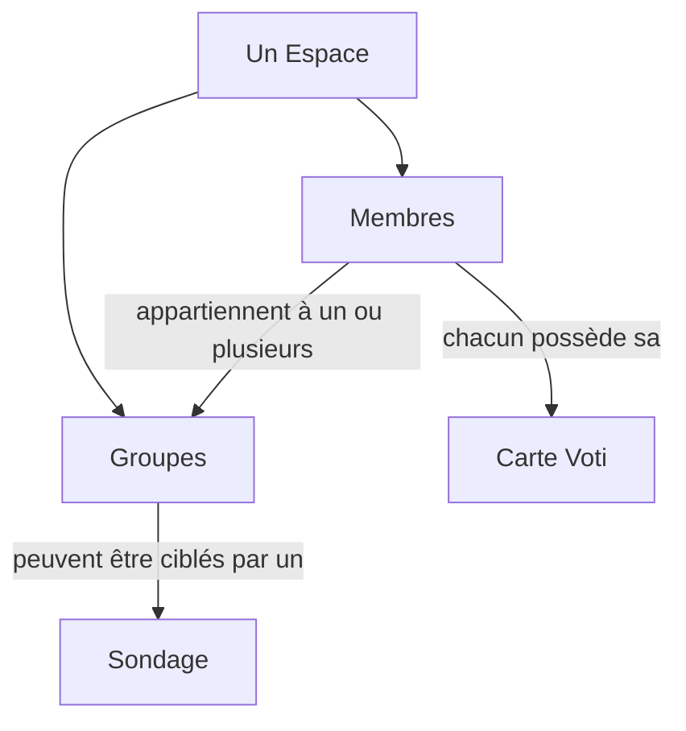

Un Espace rassemble personnes et sondages. Une Carte appartient à un membre.
Un membre peut appartenir à plusieurs groupes. Un sondage peut cibler ces groupes
ou tout l’Espace ; viennent ensuite la participation et les résultats.

## 2. Comprendre son rôle

**Un rôle Voti décrit ce que la personne peut faire dans l’application.
Il ne dépend ni de son âge ni de son métier.** Un Participant peut être enfant,
adolescent ou adulte.

### S3 — Trois rôles, trois permissions

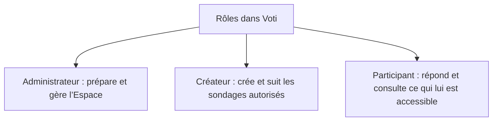

- **Administrateur :** gère l’Espace, les membres, les groupes, les Cartes et les
  accès. Il peut aussi créer et gérer les sondages.
- **Créateur :** crée et suit les sondages dans le périmètre qui lui est autorisé.
  Il ne reçoit pas automatiquement les droits de gestion des membres ou des accès.
- **Participant :** utilise sa Carte Voti pour répondre aux sondages auxquels il
  peut participer et consulter les résultats autorisés.

**Ne confondez pas les accès :** le fichier de gestion donne les droits
Administrateur/Créateur ; la Carte permet de participer, sans administrer.
Avec un accès Créateur, importez-le puis passez au [chapitre 7](#creer-sondage).
L’Administrateur prépare membres, groupes et Cartes. Avec une Carte seule,
allez au [chapitre 10](#participer).

## 3. Créer ou retrouver un Espace

### P03 — Créer un Espace

**Rôle obtenu : Administrateur.** Prévoyez Internet et un endroit privé pour conserver l’accès.

1. Dans **Espaces & groupes**, dépliez **Créer un Espace**.
2. Saisissez **Nom de l’Espace**, puis **Créer un Espace**. Effectuez la vérification
   humaine si elle est demandée.
3. Dans le nouvel Espace, conservez votre accès avec P05.

**Résultat :** l’Aperçu s’ouvre ; membres et sondages restent à préparer.

### P04 — Importer un accès et retrouver son Espace

**Administrateur ou Créateur, fichier d’accès valide reçu en privé.**

1. Ouvrez **Espaces & groupes**.
2. Sous **Importer un accès SECRET à un Espace**, choisissez **Choisir un fichier**,
   puis votre fichier d’accès de gestion.
3. Si un remplacement d’accès est proposé, vérifiez rôle et périmètre avant confirmation.

**Résultat :** l’accès vérifié ouvre l’Espace. Lors d’une prochaine visite,
utilisez **Mes Espaces → Ouvrir**.

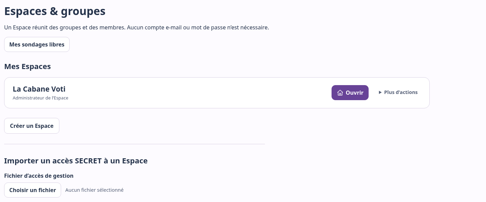

*C02 — Ouvrir retrouve l’Espace ; l’import ajoute sur cet appareil l’accès reçu.*

### P05 — Conserver son accès de gestion

**Administrateur ou Créateur, Espace accessible.** Ouvrez **Réglages → Exporter
mon accès SECRET**. Gardez le fichier dans un emplacement privé : il permettra
l’import sur un autre appareil, mais ne sauvegarde pas toutes les données.
Ne le distribuez pas aux Participants comme une Carte.

### Parcourir l’Espace

**Aperçu** donne les repères ; **Sondages** rassemble les sondages. L’Administrateur
accède aussi à **Membres**, **Groupes**, **Invitations** et **Accès**. Le Créateur
voit les sections et groupes autorisés. **Réglages** permet d’exporter son accès.

## 4. Préparer les groupes

### P09 — Créer un groupe

**Administrateur, Espace actif.**

1. Ouvrez **Groupes → Nouveau groupe**.
2. Saisissez le nom, par exemple « Soleil ».
3. Choisissez une illustration si vous le souhaitez, puis **Créer le groupe**.

**Résultat :** le groupe apparaît dans la liste. Pour lui associer des membres,
utilisez leurs fiches : il n’existe pas d’étape « ajouter un membre » depuis la
fiche du groupe.

### P10 — Modifier un groupe

**Administrateur, groupe actif.** Ouvrez **Groupes → Gérer**. Modifiez le nom ou
**Changer l’illustration**, puis **Enregistrer**. Attendez la confirmation.
**Annuler** restaure les valeurs enregistrées. Renommer ne change pas les affiliations.

### P15 — Choisir Liste ou Vignettes

Dans une section accessible, choisissez **Liste** pour une vue compacte,
ou **Vignettes** pour les illustrations. La préférence reste sur l’appareil,
séparément pour Membres et Groupes. Les données et permissions ne changent pas.

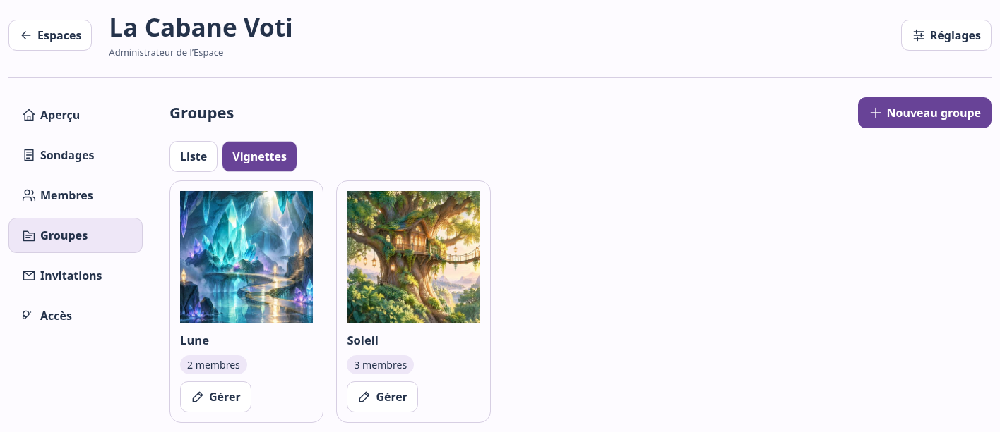

*C11 — Le nombre de membres permet de vérifier la préparation des groupes.*

## 5. Créer et modifier les membres

### P12 — Créer un membre et sa Carte

**Administrateur.** Préparez d’abord les groupes utiles.

1. Ouvrez **Membres → Ajouter un membre**.
2. Saisissez le **Nom ou pseudonyme du nouveau membre**, par exemple « Soleil A ».
3. Cochez ses groupes. Un membre peut en avoir plusieurs ou aucun.
4. Choisissez éventuellement une illustration, puis **Créer le membre et sa carte**.
5. Téléchargez la Carte qui apparaît, selon P16.

**Résultat :** le membre existe et sa Carte est déjà active. Aucune activation
supplémentaire n’est nécessaire.

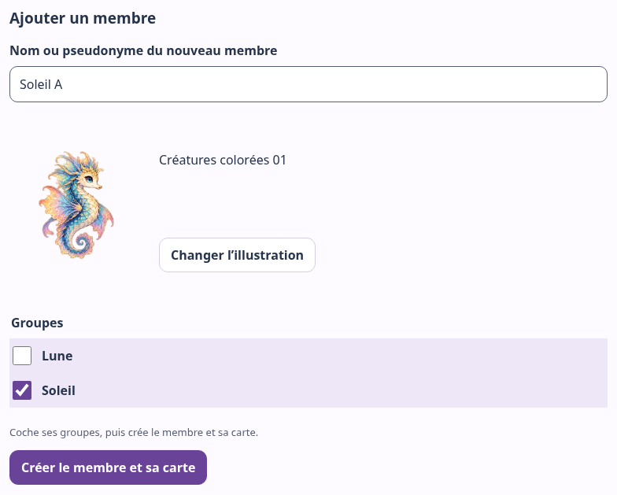

*C06 — Nom, illustration facultative et groupes sont réunis sur le même écran.*

### P13 — Modifier un membre ou ses groupes

**Administrateur, membre actif.**

1. Dans **Membres**, choisissez **Voir** sur la bonne personne.
2. Modifiez nom, illustration ou cases de groupes.
3. Dans **Modifications non enregistrées**, choisissez **Enregistrer** et attendez
   la confirmation. **Annuler** restaure les valeurs précédentes.

La barre reste accessible pendant le défilement ; sur téléphone, elle est en bas.
Les affiliations enregistrées servent aux prochains sondages : elles ne changent
pas les personnes déjà retenues pour un sondage publié.

### P14 — Choisir une illustration

**Administrateur, création ou fiche modifiable.**

1. Choisissez **Choisir une illustration** ou **Changer l’illustration**.
2. Pour un membre, filtrez si utile par **Tous**, **Créatures**, **Enfants** ou
   **Adultes**. Ce sont des catégories de dessins, pas des rôles.
3. Sélectionnez une vignette et vérifiez l’aperçu ; les contrôles sont aussi
   utilisables au clavier. Sur téléphone, touchez la vignette.
4. Choisissez **Valider mon choix**, puis enregistrez la fiche ou terminez la création.

**Aucune illustration** enlève le visuel. Voti propose uniquement les dessins
intégrés : aucune photo personnelle n’est importable ici.

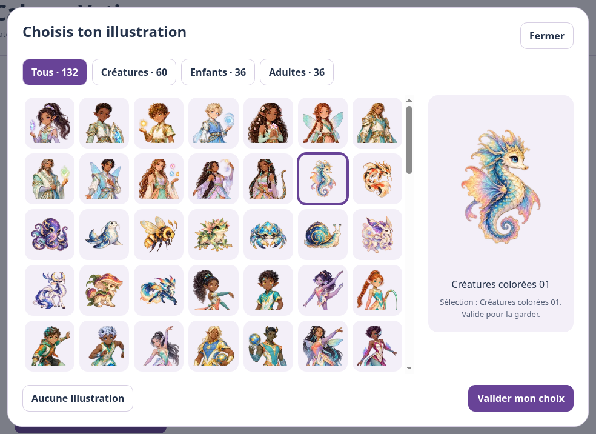

*C08 — Valider dans la galerie ne remplace pas l’enregistrement de la fiche.*

## 6. Télécharger et gérer les Cartes Voti

Une Carte Voti correspond à un membre et permet de participer en son nom. Son QR
est un accès personnel : une personne qui en possède une copie peut l’utiliser.
Ce n’est ni un accès de gestion, ni le QR d’un sondage.

### P16 — Télécharger, imprimer et remettre une Carte

**Administrateur, Carte encore disponible dans la session.**

1. Dans **Carte Voti créée**, vérifiez pseudonyme, Espace et groupes.
2. Choisissez **Voti Pop**, **Nature**, **Douceur**, **Nuit** ou **Minimal**.
   Les options d’illustration et de fond sont graphiques, sans effet sur les droits.
3. Choisissez **Télécharger cette carte (PDF SECRET)** et imprimez si nécessaire.
   Le QR entier doit rester net et non coupé.
4. Remettez la Carte à son titulaire ; gardez les copies privées.

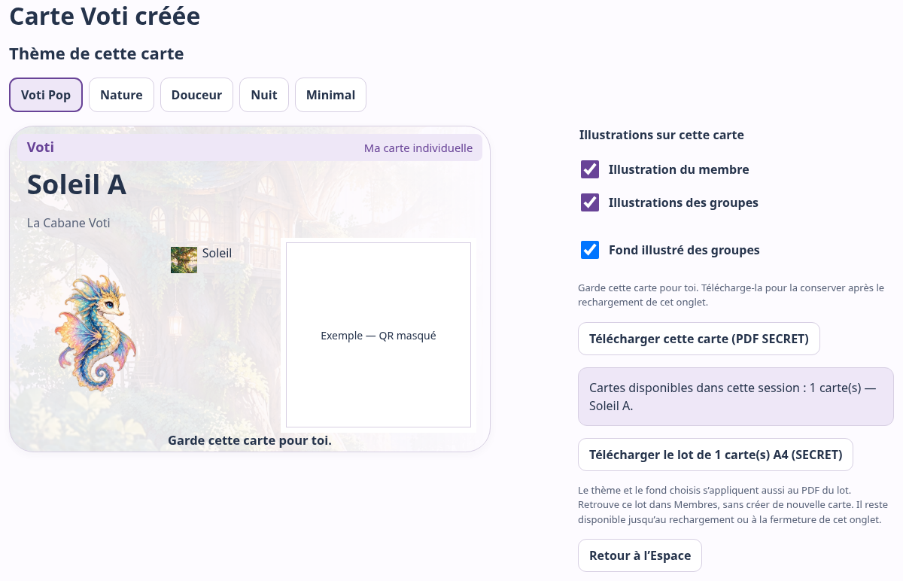

*C14 — Le QR du guide est masqué ; seule la véritable Carte permet de participer.*

### P17 — Retrouver le lot de cette session

**Administrateur, au moins une Carte exportable dans l’onglet.**

1. Dans **Membres**, ouvrez **Cartes disponibles dans cette session**.
2. Utilisez **Voir les cartes** ou **PDF des … cartes**. Choisissez thème et fond
   avant l’export.
3. Après conservation des fichiers, **Effacer de cette session** oublie ce lot,
   après confirmation.

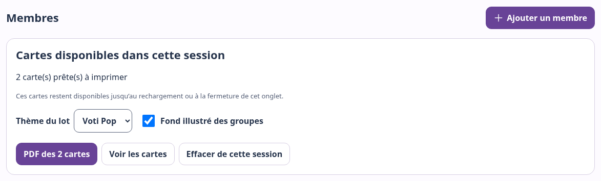

*C15 — Le panneau compte les Cartes exportables dans cet onglet.*

> **À savoir — Lot temporaire**
> Naviguer dans l’Espace conserve le lot. Recharger ou fermer l’onglet le fait
> disparaître : téléchargez les PDF avant. Effacer la session **ne révoque pas**
> les exemplaires déjà téléchargés ou imprimés.

### P18 — Créer ou remplacer plusieurs Cartes

**Administrateur, membres actifs à sélectionner.**

1. Dans **Membres**, choisissez **Gérer les cartes**.
2. Cochez uniquement les membres concernés, ou utilisez **Tout sélectionner** /
   **Tout désélectionner**. La sélection reste présente en passant de Liste à Vignettes.
3. Choisissez **Créer / remplacer … cartes** et lisez la confirmation.
4. Confirmez seulement après avoir vérifié les personnes et les remplacements annoncés.
5. Lisez le bilan, puis téléchargez le PDF du nouveau lot.

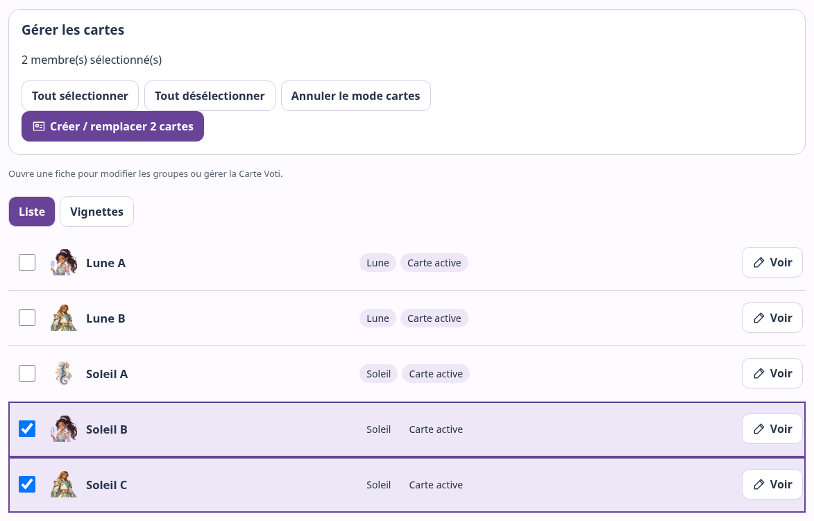

*C16 — Les cases cochées définissent les Cartes qui seront créées ou remplacées.*

> **Attention — Les anciennes Cartes seront invalidées**
> Pour chaque membre sélectionné, une nouvelle Carte est émise. S’il en avait déjà
> une, l’ancienne ne fonctionne plus. Les membres non sélectionnés ne changent pas.
> Cette opération n’est pas une simple réimpression.

Le **PDF de ces … cartes** contient le nouveau lot. Le **PDF des … cartes** contient
l’ensemble disponible dans la session. Une nouvelle Carte s’ajoute au lot ;
remplacer celle d’un membre remplace son ancienne entrée.

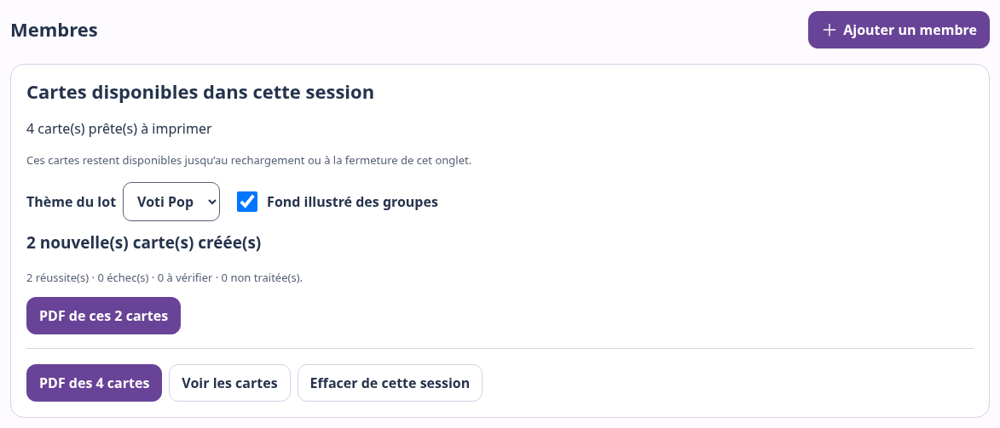

*C19 — Les deux boutons PDF correspondent à des ensembles différents.*

Si le lot est interrompu, conservez le PDF des réussites et lisez les nombres
**échecs**, **à vérifier** et **non traitées**. Si **Vérifier les cartes** apparaît,
utilisez-le avant de relancer une émission incertaine. N’en déduisez pas que toute
la sélection a réussi, ni que toute l’opération a été annulée.

### P19 — Remplacer ou révoquer une seule Carte

**Administrateur, fiche du bon membre ouverte avec Voir.** Regardez aussi dans
**Actions à utiliser avec précaution**.

- **Remplacer :** choisissez **Régénérer la carte**, confirmez **Régénérer**, puis
  téléchargez la nouvelle Carte.
- **Révoquer :** choisissez **Révoquer la carte**, puis confirmez. Aucune nouvelle
  Carte n’est émise ; une régénération reste possible pour ce membre actif.

> **Attention — Trois actions différentes**
> Remplacer invalide l’ancienne Carte et en fournit une nouvelle. Révoquer coupe
> son accès sans fournir de Carte. Réimprimer utilise un PDF conservé sans changer
> sa validité. Les votes passés restent ; aucun second vote n’est donné au membre.

Le serveur ne permet pas de reconstituer une Carte perdue. Sans PDF conservé ni
lot temporaire, il faut la remplacer.

## 7. Créer un sondage dans l’Espace

**Administrateur ou Créateur autorisé, membres et groupes prêts.**

Ouvrez l’Espace puis **Sondages → Nouveau sondage**. Express, Guidée et Réglages
avancés proposent le même fonctionnement avec un accompagnement différent.
Aucune présentation n’est meilleure pour tout le monde. Toutes créent un
**brouillon**, pas un vote ouvert.

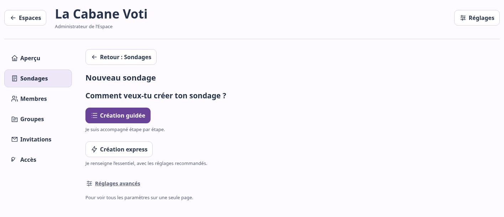

*C21 — Le sondage appartiendra à l’Espace indiqué en haut.*

### P23 — Créer un brouillon Express

1. Choisissez **Création express**.
2. Saisissez la question « Quelle activité vendredi ? » et les réponses Parc,
   Cinéma, Jeux. Vous pouvez proposer de **2 à 6 réponses**.
3. Pour **Qui peut participer ?**, choisissez **Certains groupes**, puis **Soleil**.
   Vérifiez que **3 membres concernés** est indiqué.
4. Lisez les réglages recommandés, puis choisissez **Créer le brouillon**.

**Résultat :** la gestion du brouillon s’ouvre. Express propose un vote **anonyme**,
**sans commentaire**, avec résultats pour les membres concernés après le minimum
requis. Pour les trois membres de Soleil, la recommandation est **2**.
Vous pourrez ajuster les réglages sur cet écran de gestion, avant publication.

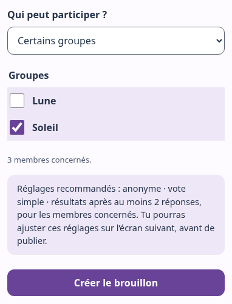

*C22 — Express annonce les réglages appliqués et la possibilité de les ajuster ensuite.*

### P24 — Créer un brouillon Guidé

Choisissez **Création guidée**, puis avancez avec **Continuer** :

1. **Ta question :** saisissez « Quelle activité vendredi ? ».
2. **Tes réponses :** saisissez Parc, Cinéma et Jeux ; ajoutez, retirez ou ordonnez
   les réponses si nécessaire.
3. **Qui peut participer ? :** sélectionnez **Certains groupes → Soleil** ; vérifiez
   les trois membres concernés.
4. **Comment participer ? :** choisissez **Anonyme** et **Vote simple** pour notre exemple.
5. **Quand montrer les résultats ? :** choisissez **Quand tout le monde a répondu
   ou que je ferme le sondage**. Conservez le minimum 2 et les membres concernés
   comme personnes pouvant voir les résultats.
6. **Vérifie ton sondage :** relisez le résumé. Les boutons **Modifier** ramènent
   au réglage correspondant. Choisissez ensuite **Créer le brouillon**.

**Résultat :** le brouillon est enregistré avec vos choix. Dans cet exemple Guidé,
les résultats attendront tous les participants ou la fermeture, même avec deux votes.
Il s’agit d’un sondage distinct de l’exemple Express.

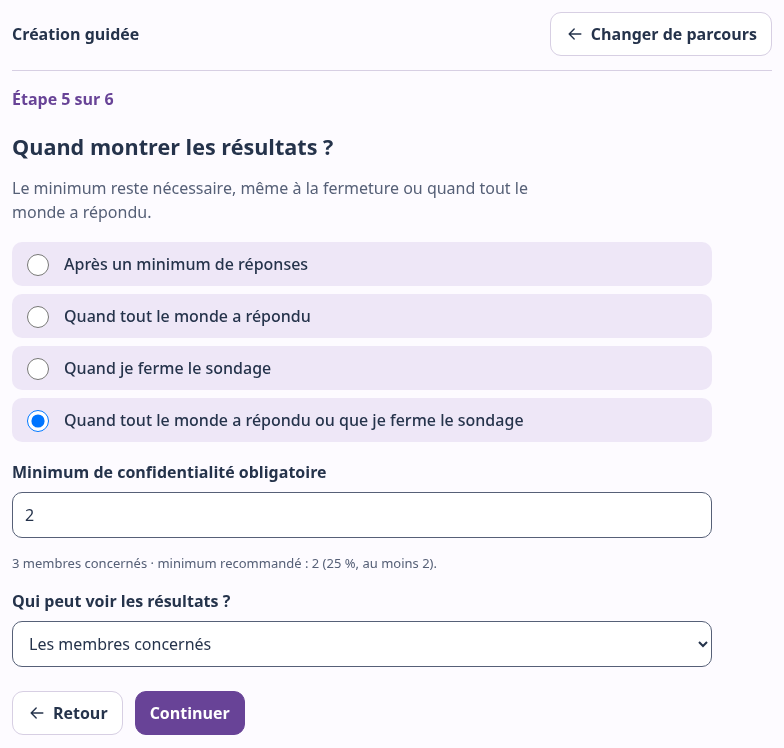

*C27 — La règle « tout le monde ou fermeture » conserve un minimum de confidentialité.*

### P25 — Utiliser Réglages avancés

Choisissez **Réglages avancés**. Renseignez question, réponses, audience,
participation, commentaires et résultats ; relisez puis **Créer le brouillon**.

Visiter une autre présentation conserve les saisies. Soumettre **en Express**
applique cependant ses réglages recommandés de participation et résultats.
Pour garder vos choix détaillés, soumettez en Guidée/Avancé, ou ajustez le brouillon.

### Comprendre le minimum recommandé

Voti propose **25 % des personnes pouvant participer, arrondi au supérieur,
avec un minimum recommandé de 2**.

| Personnes concernées | Minimum recommandé |
| --- | --- |
| 3 | 2 |
| 9 | 3 |
| 20 | 5 |

Un membre appartenant à plusieurs groupes sélectionnés ne compte qu’une fois.
La proposition s’adapte à l’audience tant que vous ne l’avez pas personnalisée.
Une valeur saisie manuellement est conservée quand les groupes changent.
**Utiliser la recommandation** permet de revenir au calcul automatique.
À la réouverture d’un brouillon, Voti préserve prudemment la valeur enregistrée.

> **À savoir — Minimum et résultats**
> Le minimum est une recommandation ajustable avant publication. Une fois
> enregistré pour le sondage, il reste une condition de disponibilité des résultats.
> Il aide à protéger la confidentialité des petits résultats, mais l’atteindre
> ne suffit pas toujours : la règle choisie compte aussi.

Pour zéro ou une personne éligible, la recommandation reste 2. Cette audience ne
peut donc pas l’atteindre, même après fermeture. Vérifiez les membres et les groupes
avant publication ; Voti ne réduit pas automatiquement la recommandation à 1.

## 8. Modifier et enregistrer un sondage

### P26 — Ajuster un sondage encore modifiable

**Administrateur ou Créateur autorisé, brouillon ou sondage ouvert sans vote.**

1. Dans **Sondages → Gérer**, lisez l’état et le résumé, puis dépliez
   **Modifier le sondage**, fermé par défaut.
2. Dans **L’essentiel**, ajustez question, description ou réponses. L’audience
   n’est modifiable que dans le brouillon.
3. Dépliez **Participation et résultats** pour **Affiner les réglages**.
4. Dans la barre des modifications, choisissez **Enregistrer les règles**.
   Attendez **Modifications enregistrées.**

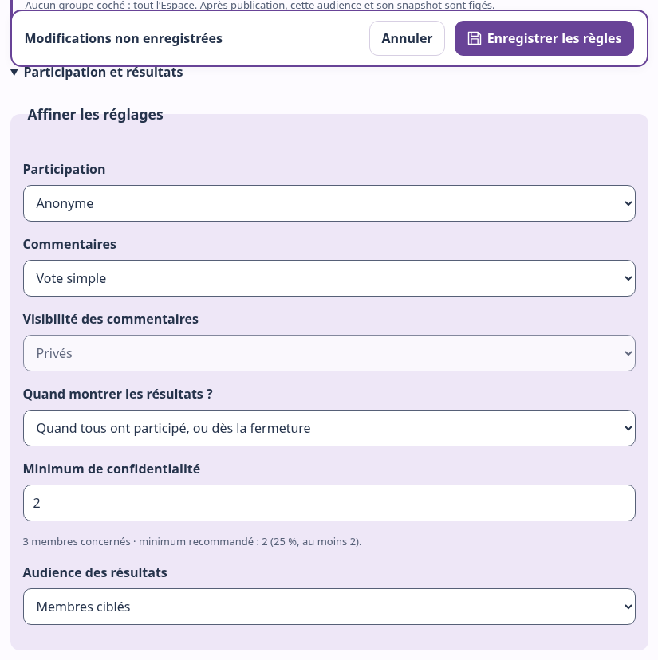

*C30 — La barre de sauvegarde reste accessible pendant le défilement.*

**Annuler** restaure les valeurs enregistrées. Avant de partir sans sauvegarder,
Voti propose de continuer l’édition ou d’abandonner. En cas d’erreur, gardez la
saisie, vérifiez la connexion et réessayez ; attendez une confirmation de succès.

| État | Ce qui peut changer |
| --- | --- |
| Brouillon | Contenu, audience et réglages autorisés |
| Ouvert, aucun vote | Contenu et réglages autorisés ; personnes retenues à publication inchangées |
| Premier vote reçu | Question, réponses et règles verrouillées ; apparence distincte |
| Fermé | Plus de vote ni d’édition du fond ; apparence encore accessible |

## 9. Publier et partager

### P27 — Publier pour les membres

**Administrateur ou Créateur autorisé, brouillon vérifié.**

1. Ouvrez **Gérer** et relisez le résumé : question, réponses, groupes, participation,
   règle de résultats et minimum.
2. Vérifiez que les bons membres sont actifs et dans les bons groupes.
3. Choisissez **Publier pour les membres**.

**Résultat :** le sondage passe à **Ouvert** ; le suivi des participations apparaît.
Créer ou enregistrer le brouillon n’avait pas encore ouvert le vote.

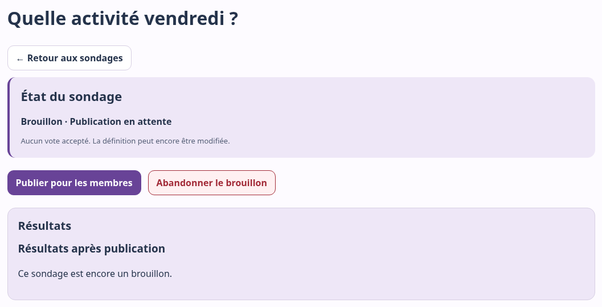

*C29 — Publier ouvre le sondage ; abandonner supprime ce brouillon non publié.*

> **À savoir — Les personnes retenues au moment de la publication**
> Voti fixe alors les membres pouvant participer. Modifier ensuite leurs groupes
> n’ajoute ni ne retire rétroactivement des personnes de cette audience. Publier
> fixe cette liste ; le premier vote verrouille ensuite le contenu et les règles.

### P28 — Partager le bon accès au sondage

**Administrateur ou Créateur autorisé, sondage publié.**

1. Choisissez **QR & partager le sondage** dans la gestion.
2. Copiez le lien de vote ou téléchargez le QR. Les entrées **Un QR pour chaque
   choix**, **QR résultats** et **Créer une affiche PDF** répondent à d’autres besoins.
3. Partagez le lien ou l’affiche avec les personnes concernées.

Le QR du sondage ouvre le parcours ; celui d’une réponse propose un choix à
confirmer. Les Participants doivent encore présenter leur Carte. Ne partagez
à leur place ni un accès de gestion ni une invitation.

## 10. Participer à un sondage

### S2 — Du sondage au vote

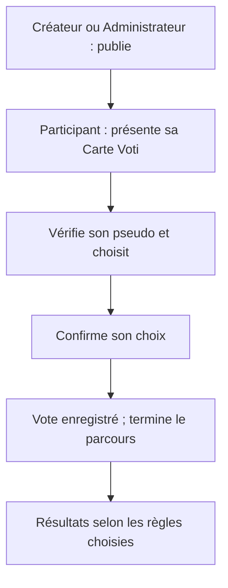

### P29 — Présenter sa Carte, choisir et confirmer

**Participant, Carte active, sondage ouvert et participation autorisée.**
Sur un appareil partagé, utilisez un profil sans accès de gestion enregistré.

1. Ouvrez le lien ou le QR du sondage, puis **Scanner ma Carte Voti**.
   Autre entrée : accueil **Présenter ma Carte Voti**, puis **Voter** dans **Mon espace**.
2. Choisissez **Scanner avec la caméra**, autorisez-la si demandé et présentez le
   QR entier. **Choisir un fichier** accepte aussi une photo de votre Carte ; gardez-la privée.

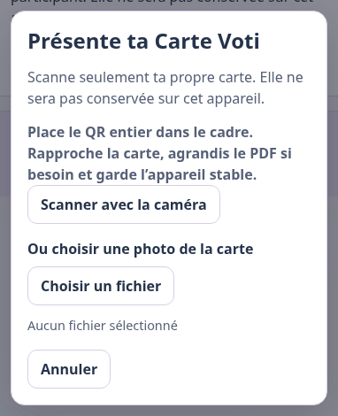

*C34 — La Carte ne sera pas conservée sur cet appareil par le parcours participant.*

3. Vérifiez **Carte reconnue : …**. Mauvais pseudo ? Ne confirmez pas ; quittez
   puis présentez votre propre Carte.
4. Choisissez une réponse, puis **Continuer**.

*C35 — Présenter sa Carte et choisir une réponse n’envoie pas de vote.*

5. Vérifiez **Tu choisis : …**. **Autre choix** permet de revenir. Un commentaire
   facultatif peut être proposé selon le sondage.
6. Choisissez **Oui, je confirme**. Attendez **Merci ! Ton vote a bien été enregistré.**
7. Choisissez **Accueil**, ou **Participant suivant** sur un appareil partagé.
   Dans Mon espace ou les résultats, **Terminer** quitte la participation.

*C36 — La confirmation envoie le vote.*

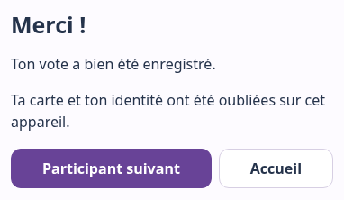

*C37 — Le message de succès confirme l’envoi ; Accueil ou Participant suivant permet de poursuivre.*

**Résultat :** le vote est enregistré et l’identité temporaire est oubliée au
succès. **Terminer** met aussi fin à l’accès temporaire ; la Carte reste valable
pour d’autres sondages. Un même membre ne peut pas voter deux fois à ce sondage,
même après remplacement de sa Carte. Aucun vote n’est accepté après fermeture.

## 11. Suivre les participations et fermer

### P31 — Lire le suivi

**Administrateur ou Créateur autorisé.** Dans **Sondages → Gérer**, le haut de page
indique **X participations sur Y**. Y est le nombre de personnes retenues à
publication, sans recalcul selon les groupes actuels.

Dans l’exemple Guidé, **2 participations sur 3** atteint le minimum, mais la règle
attend la dernière participation ou la fermeture. En anonyme, aucune liste
nominative de votants ou non-votants n’est disponible.

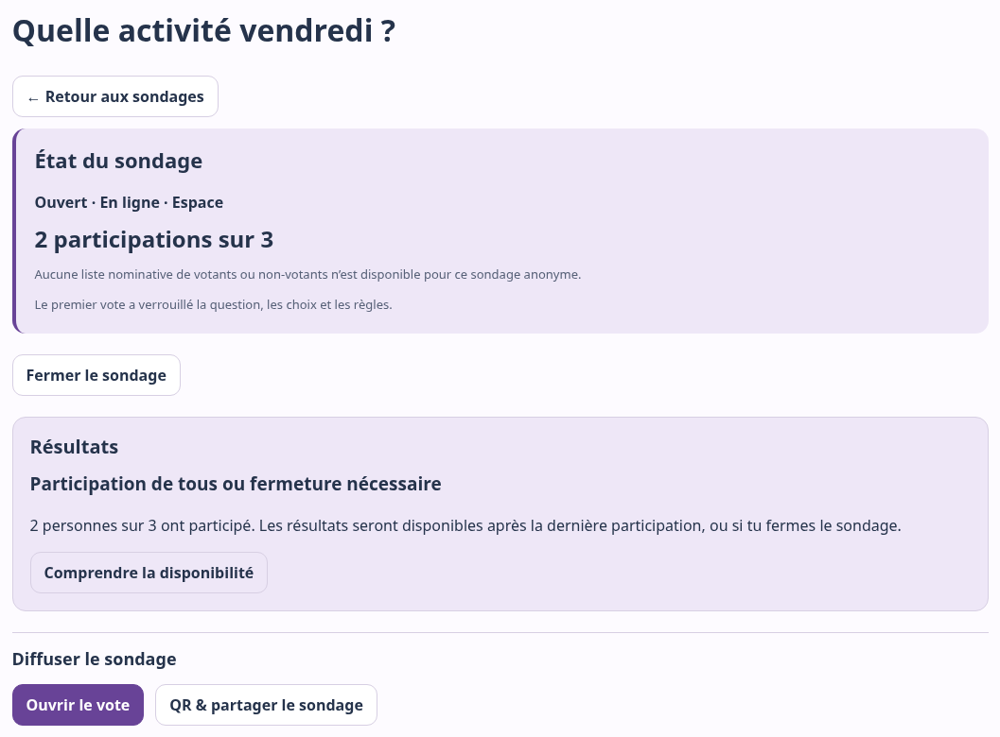

*C31 — Le motif près de Résultats indique ce qui manque encore.*

### P32 — Fermer le sondage

**Administrateur ou Créateur autorisé, sondage ouvert.**

1. Dans la gestion, choisissez **Fermer le sondage**.
2. Lisez la confirmation, puis confirmez avec **Fermer le sondage**.
3. Vérifiez l’état **Fermé** et la disponibilité des résultats.

**Résultat :** plus aucun vote n’est accepté. Les votes déjà reçus sont conservés.
Fermer ne supprime pas le sondage et **ne contourne jamais le minimum**.

## 12. Comprendre et consulter les résultats

### S4 — Pourquoi attendre les résultats ?

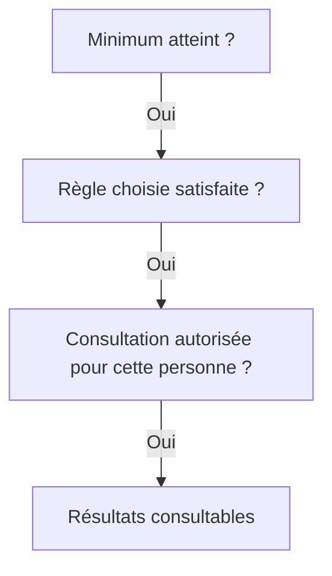

Si l’une des réponses est non, les résultats ne sont pas accessibles à cette
personne. Il faut distinguer **combien de votes**, **à quel moment** et **pour qui**.

| Règle choisie | Condition, en plus du droit de consultation |
| --- | --- |
| À partir du minimum de participations | Le minimum enregistré est atteint |
| Quand tous les membres concernés ont participé | Tous ont participé **et** le minimum est atteint |
| Quand le sondage est fermé | Le sondage est fermé **et** le minimum est atteint |
| Quand tous ont participé, ou dès la fermeture | Tous ont participé **ou** le sondage est fermé ; le minimum reste nécessaire |

Le réglage **Administration uniquement** réserve la consultation aux personnes
ayant les droits de gestion de ce sondage. Leurs droits ne leur permettent pas
de contourner le minimum ni la règle choisie.

### P30 — Lire les résultats

**Gestion autorisée ; Participant si la consultation lui est ouverte.**

1. Dans la gestion, lisez **Résultats** et son motif. Choisissez **Voir les résultats**
   si disponibles, sinon **Comprendre la disponibilité**. Cliquer ne les débloque pas.
2. Côté Participant, présentez votre Carte si nécessaire. Dans **Mon espace**,
   **Résultats disponibles** apparaît quand la consultation est permise.
3. Lisez le total et la répartition ; terminez le parcours sur un appareil partagé.

**Guidée :** à 2/3, notre exemple attend. Après fermeture, le minimum étant atteint,
les résultats s’ouvrent : **Parc 1, Cinéma 1, Jeux 0**. Le troisième membre peut les
consulter s’il y est autorisé, mais ne peut plus voter.
**Express :** la règle du minimum seul autorise ici les résultats dès deux votes,
même pendant l’ouverture. Ce sont deux sondages distincts.

*C33 — Totaux et pourcentages, sans nom de Participant.*

### Anonyme ou identifié : que voit la gestion ?

- **Anonyme :** la gestion voit le nombre de participations, sans association
  directe entre un membre et sa réponse, ni liste nominative des votants/non-votants.
- **Identifiée avec la Carte Voti :** la gestion autorisée peut relier le membre
  à sa participation et à sa réponse. Les résultats destinés aux membres ne
  publient pas ces identités.

Annoncez ce choix avant de faire participer. Le mode anonyme de Voti ne promet
pas un anonymat absolu sur le réseau ou l’infrastructure. Dans un petit groupe,
le contexte ou un commentaire peut aussi permettre de reconnaître quelqu’un.

## 13. Invitations et accès de gestion

### P21 — Créer ou fermer une invitation

**Administrateur.** Une invitation crée un nouveau membre et sa Carte, pas un accès de gestion.

1. Ouvrez **Invitations → Nouvelle invitation**.
2. Choisissez groupes, maximum d’utilisations et expiration.
3. Vérifiez le récapitulatif, puis **Créer une invitation** et confirmez.
4. Copiez le lien secret ou téléchargez le QR immédiatement. Il ne pourra plus
   être réaffiché après avoir quitté cet écran. Partagez-le seulement en privé.

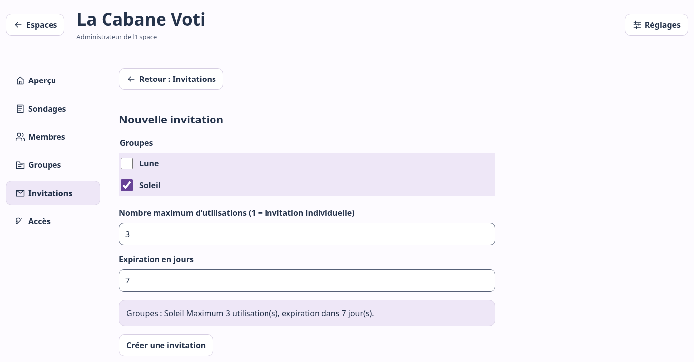

*C20 — Vérifier groupes, maximum et durée avant confirmation.*

Pour arrêter les inscriptions, ouvrez l’invitation et **Fermer l’invitation**.
Cela ne supprime pas les membres déjà créés. Une invitation expirée ou épuisée
ne permet plus de rejoindre l’Espace.

### P22 — Rejoindre avec une invitation

**Participant, invitation valide reçue en privé.** Ouvrez son lien/QR, renseignez
**Ton nom ou pseudonyme**, puis **Créer ma Carte Voti**. Téléchargez immédiatement
la Carte ; **Ouvrir Mon espace** mène à la participation.

**Résultat :** un nouveau membre rejoint les groupes prévus. Pour retrouver un
membre existant, utilisez sa Carte plutôt qu’une invitation : cela évite un doublon.

### P06 — Déléguer un accès de gestion

**Administrateur, groupes prêts si périmètre limité.**

1. Ouvrez **Accès → Créer un accès** ; choisissez **Créateur** ou **Administrateur**.
2. Pour un Créateur, cochez les groupes autorisés. Aucun coché signifie tout
   l’Espace ; l’Administrateur a accès à tout l’Espace.
3. Choisissez **Créer un accès de gestion SECRET**. Conservez le fichier téléchargé
   et transmettez-le en privé. La personne l’importe avec P04.

**Résultat :** elle reçoit les permissions choisies, pas seulement un droit de vote.

### P07 — Révoquer un accès de gestion

**Administrateur, accès concerné clairement identifié.**

Dans **Accès**, ouvrez sa fiche, choisissez **Révoquer cet accès**, puis confirmez.

> **Attention — Retrait des droits de gestion**
> Cet accès ne pourra plus gérer l’Espace. Cela ne supprime ni l’Espace ni ses
> sondages. Le dernier accès Administrateur est protégé contre la révocation.
> Vérifiez qu’un accès Administrateur utilisable reste disponible.

### P08 — Retirer l’accès de cet appareil

**Administrateur ou Créateur, fichier exporté et conservé ailleurs.**

Dans **Espaces & groupes → Mes Espaces → Plus d’actions**, choisissez
**Retirer cet accès de cet appareil**, puis confirmez **Oublier cet accès**.
Cela oublie la copie locale et les Cartes temporaires de cet Espace, sans le
supprimer ni révoquer l’accès côté serveur. Pour revenir, importez le fichier P04.

## 14. Installer Voti sur son appareil

### P02 — Installer et lancer Voti

**Tous les rôles, navigateur compatible et installation autorisée.**
Voti fonctionne dans le navigateur. Installer est facultatif : une icône ouvre le
même Voti dans une fenêtre dédiée, sans store ni application Android native.

1. Ouvrez [Voti](https://luuma8888.github.io/voti/).
2. Sur **Android/Chrome**, menu ⋮ → **Installer l’application** ou **Ajouter à
   l’écran d’accueil**. Sur **Chromebook**, utilisez l’installation dans la barre
   d’adresse ou le menu Chrome. Sur **ordinateur**, Chrome/Edge peuvent la proposer.
3. Confirmez, puis lancez Voti depuis son icône.

**Résultat :** l’accueil s’ouvre dans une fenêtre dédiée. Si l’installation n’est
pas proposée, gardez le navigateur. Les libellés varient ; un appareil géré peut
nécessiter une autorisation.

> **C39 — capture humaine à fournir :** menu natif Chrome Android proposant
> l’installation, sur l’accueil neutre. Aucune image de substitution.

> **C40 — capture humaine à fournir :** Voti réellement lancé depuis son icône
> dans une fenêtre dédiée Chromebook/ordinateur.

**Installer ne crée pas un compte, ne transfère pas les accès entre appareils,
ne sauvegarde pas les Cartes et ne rend pas les Espaces utilisables hors connexion.**
Les mises à jour suivent le site Web. Pour retrouver la version publiée, rechargez
ou fermez puis rouvrez l’application, hors vote ou modification en cours et après
avoir téléchargé les Cartes temporaires utiles. Un lien reçu peut s’ouvrir dans
le navigateur plutôt que la fenêtre installée.

## 15. Données, confidentialité et précautions

### Utiliser des pseudonymes

Les données des Espaces sont enregistrées en ligne : noms/pseudos, groupes,
illustrations choisies et sondages. Les réponses et éventuels commentaires sont
conservés avec le sondage. Saisissez seulement ce qui est utile. Un pseudo n’est
pas une identité vérifiée ; des doublons restent possibles.

### Protéger les Cartes Voti

PDF, photos et impressions restent privés : une copie du QR permet d’utiliser la
Carte. Ne l’envoyez pas dans une demande d’aide publique. En cas de perte ou copie,
l’Administrateur peut la remplacer, pas récupérer son secret d’origine.

### Protéger les accès de gestion

Le navigateur garde l’accès importé. Protégez appareil et fichiers ; évitez ce
profil pour un appareil de vote partagé. **Retirer cet accès de cet appareil**
oublie la copie locale ; **Révoquer cet accès** retire les droits côté serveur.

### Comprendre le mode anonyme

Le compteur n’offre pas de lien direct nom/réponse. Un nom ou détail dans un
commentaire peut pourtant identifier quelqu’un. Expliquez identité, commentaires
et résultats avant le vote ; la fermeture ne change pas la confidentialité.

### Supprimer, révoquer et archiver

Révoquer retire un accès sans effacer les votes antérieurs. Archiver arrête des
usages actifs en conservant l’historique. Supprimer un sondage efface ses données
en ligne, mais pas les PDF/impressions déjà distribués. Voir les actions ci-dessous.

### Conserver les fichiers avec précaution

Accès de gestion, Cartes et résultats sont des fichiers distincts. L’export JSON
général du Mode libre ne sauvegarde pas Espaces, accès, Cartes ou historique distant.
Installer Voti n’est pas une sauvegarde.

Le brouillon distant d’Espace a une préparation limitée à **24 heures** : ce n’est
pas une archive. Un sondage publié/fermé n’expire pas automatiquement ; fermer ne
l’efface pas. Les personnes responsables de l’Espace décident de la conservation
des données et copies selon leur usage. Ce guide ne fixe pas une durée universelle
et ne promet pas l’effacement de toutes les sauvegardes de l’hébergeur.

## 16. Actions avancées

### P33 — Participation identifiée et commentaires

**Administrateur ou Créateur autorisé, avant verrouillage pour les réglages.**
Dans la création ou **Modifier le sondage → Participation et résultats**, choisissez
**Anonyme** ou **Identifiée avec la Carte Voti**, puis **Vote simple** ou
**Vote + commentaire facultatif**. Enregistrez avant de faire voter.

Les commentaires **Privés** restent en gestion ; **Approuvés avec les résultats**
permet de publier les commentaires approuvés lorsque les résultats sont disponibles.
Le commentaire reste facultatif. Évitez les informations personnelles.

Dans la gestion publiée, ouvrez **Commentaires** ou **Participations & commentaires** :

1. Lisez les entrées. Pour un commentaire publiable, **Afficher** approuve,
   **Masquer** retire de l’affichage. Un commentaire privé n’est pas publiable.
2. **Supprimer** demande confirmation : seul le commentaire est supprimé, pas le
   vote. Son texte n’est pas éditable.

La gestion peut lire les commentaires avant le minimum sans ouvrir les résultats
à tous. En identifié, **Suivi des participants** filtre aussi ceux qui ont participé
ou restent à relancer ; cette liste n’existe pas en anonyme.

### P34 — Apparence, affiche et export des résultats

**Administrateur ou Créateur autorisé.**

- **Apparence du sondage :** ouvrez le bloc dans la gestion, choisissez puis
  **Enregistrer l’apparence**. Le contenu verrouillé ne change pas.
- **Affiche :** **QR & partager le sondage → Créer une affiche PDF** ouvre le Studio.
  Préparez et vérifiez l’aperçu avant export/impression.
- **Résultats disponibles :** ouvrez **Télécharger les résultats en PDF** ; choisissez
  synthèse ou rapport et les options proposées, puis exportez.

Les commentaires publiés peuvent être inclus sur option. Les identités sont
réservées à la gestion identifiée, sur choix explicite désactivé par défaut.
Vérifiez les destinataires : un rapport nominatif n’est ni une synthèse sans
identité ni un PDF de Cartes secrètes.

### P11 — Archiver un groupe

**Administrateur, fiche d’un groupe actif.**

Ouvrez **Groupes → Gérer → Actions à utiliser avec précaution**, choisissez
**Archiver le groupe**, puis confirmez. Voti refuse l’archivage si des sondages
actifs le bloquent. Les membres et l’historique ne sont pas supprimés ; ce groupe
ne sert plus aux usages actifs comme auparavant.

### P20 — Révoquer un membre

**Administrateur, fiche du membre concerné.**

Ouvrez **Membres → Voir → Actions à utiliser avec précaution**, choisissez
**Révoquer le membre**, puis confirmez.

> **Attention — Retrait de la participation du membre**
> Sa Carte est invalidée et il ne peut plus participer. Son historique, ses votes
> antérieurs et les personnes retenues pour les sondages publiés sont conservés.
> Ce n’est pas une suppression complète de ses données.

### P35 — Abandonner ou supprimer un sondage

**Administrateur ou Créateur autorisé, bon sondage vérifié.**

- **Brouillon :** dans la gestion, choisissez **Abandonner le brouillon**, puis
  confirmez **Abandonner**. Le sondage non publié est supprimé.
- **Publié ou fermé :** dépliez **Suppression du sondage**. Choisissez **Supprimer
  en ligne**, ou **Supprimer partout** pour retirer aussi le design de cet appareil.
  Lisez et confirmez l’action choisie.

> **Attention — Suppression du sondage**
> Le sondage, ses votes, commentaires et liens de participation associés sont
> supprimés en ligne. Cette action est irréversible dans l’interface. Les PDF et
> impressions déjà diffusés ne sont pas retirés. « Partout » ne signifie pas
> effacer à distance les fichiers des autres personnes.

### P36 — Renommer ou archiver un Espace

**Administrateur.**

Pour corriger le nom, ouvrez **Réglages**, modifiez **Nom de l’Espace**, puis
**Renommer l’Espace**.

Pour arrêter ses usages actifs, dépliez **Actions à utiliser avec précaution**,
choisissez **Archiver l’Espace**, puis confirmez.

> **Attention — Archivage de l’Espace**
> Les Cartes et les accès Créateur sont désactivés ; l’Administrateur peut
> encore consulter l’historique. Ce n’est pas une suppression totale. Cette version
> ne propose pas de réactivation dans l’interface : n’archivez pas pour faire une pause.

## 17. Retrouver de l’aide

Commencez par relever **l’écran**, **le message affiché** et **votre rôle**.
Contactez la personne responsable de votre Espace ou le support Voti s’il vous a
été communiqué. N’envoyez pas de Carte, de lien secret ou de fichier d’accès sur
un canal public.

| Situation | Première action utile |
| --- | --- |
| Mes Espaces est vide sur un nouvel appareil | Importer le fichier d’accès de gestion, P04 ; installer Voti ne le transfère pas |
| Le fichier d’accès est perdu, mais l’Espace s’ouvre encore | Exporter l’accès depuis Réglages, P05 |
| Le pseudo reconnu n’est pas le bon | Ne pas confirmer ; quitter puis présenter la bonne Carte, P29 |
| Le sondage n’apparaît pas pour un membre | Vérifier publication et personnes retenues ; changer de groupe après publication ne suffit pas |
| Résultats indisponibles | Lire le motif ; distinguer minimum, règle et personnes autorisées, P30 |
| La saisie n’est pas enregistrée | Utiliser la barre Enregistrer et attendre la confirmation, P26/P13 |
| Le lot de Cartes a disparu après rechargement | Retrouver un PDF conservé ou remplacer les Cartes nécessaires, P17/P19 |
| Installation absente | Continuer dans le navigateur, P02 |

**Limites de récupération :** il n’existe pas de récupération automatique par
courriel. Si tous les accès de gestion sont perdus, une procédure d’intervention
extérieure n’est pas définie dans l’application. Ne recréez pas un Espace en
pensant retrouver ses données. Une Carte peut être remplacée, mais pas reconstituée
depuis son secret serveur ; un Espace archivé n’a pas de restauration documentée
par l’interface.

## Repères de procédures

- **Entrer :** [P01](#p01) accueil ; [P02](#p02) installation ; [P03](#p03) création d’Espace ; [P04](#p04) import ; [P05](#p05) export.
- **Accès :** [P06](#p06) déléguer ; [P07](#p07) révoquer ; [P08](#p08) oublier sur l’appareil.
- **Personnes :** [P09](#p09)–[P11](#p11) groupes ; [P12](#p12)–[P13](#p13) membres ; [P14](#p14) illustration ; [P15](#p15) Liste/Vignettes.
- **Cartes :** [P16](#p16) PDF ; [P17](#p17) session ; [P18](#p18) lot ; [P19](#p19) remplacer/révoquer ; [P20](#p20) révoquer un membre.
- **Invitations :** [P21](#p21) créer/fermer ; [P22](#p22) rejoindre.
- **Sondages :** [P23](#p23) Express ; [P24](#p24) Guidée ; [P25](#p25) Avancé ; [P26](#p26) modifier ; [P27](#p27) publier ; [P28](#p28) partager.
- **Participation :** [P29](#p29) voter ; [P30](#p30) résultats ; [P31](#p31) suivi ; [P32](#p32) fermer.
- **Avancé :** [P33](#p33) identité/commentaires ; [P34](#p34) apparence/exports ; [P35](#p35) supprimer ; [P36](#p36) régler l’Espace.

---

### Référence et export de cette édition

D2 fondé sur le commit `601aeb04c171fae6b4f4928d694f9ce8c4ddf190`, branche `main`.
La [baseline pilote](PILOT_BASELINE.md) reste gelée ; la PWA est postérieure.
Les recettes humaines Guidée/Express restent acquises pour leurs configurations,
sans validation supplémentaire de toutes les variantes.

Sources : [plan du kit](VOTI_GUIDE_KIT_PLAN.md), [installation](PWA.md), règles du
HEAD vérifiées pour les procédures. Les 20 PNG disponibles proviennent de la
banque nettoyée C01–C38 ; la sélection imprimée est définie dans
[la génération des guides](guides/README.md). Aucun nouveau cliché n’a été réalisé.

Les PDF et HTML sont produits par `guides/build_guides.py`, avec une charte commune
A4, une colonne et un corps lisible. S1–S4 ont leurs sources SVG dans
`guides/diagrams/`. Les vues natives C39/C40 pourront être ajoutées ultérieurement ;
l’édition distribuable fournit la procédure d’installation textuelle.
Le manifeste de génération consigne pagination, référence, sources et empreintes.
